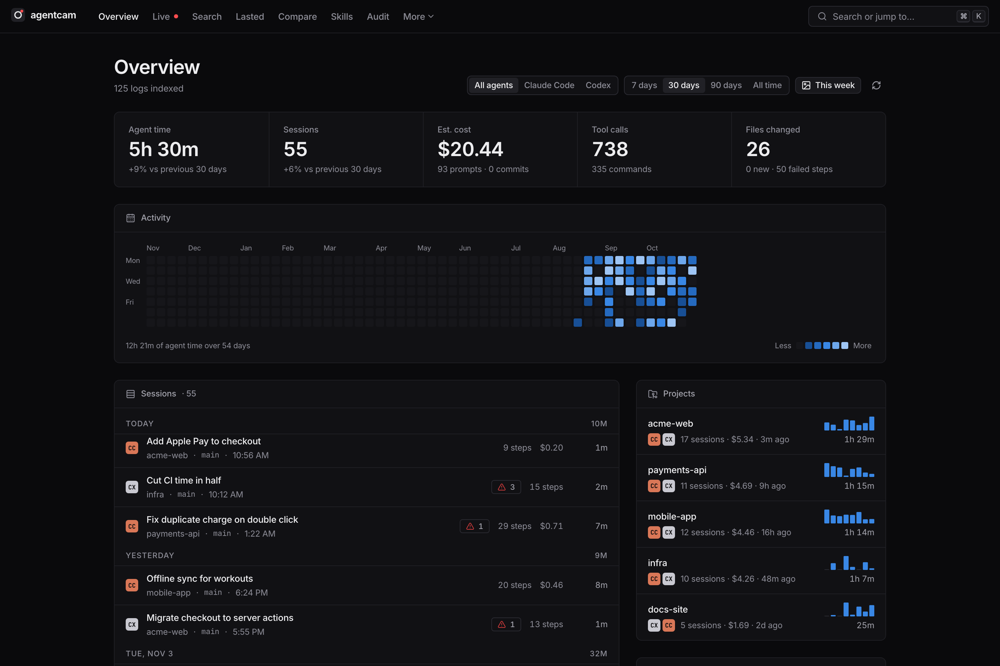
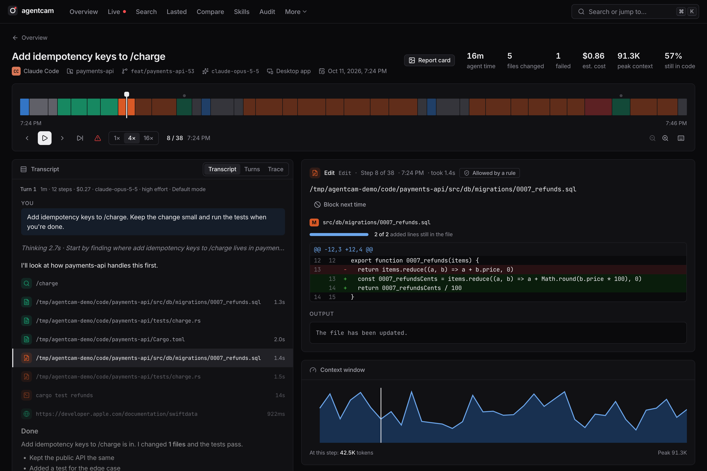
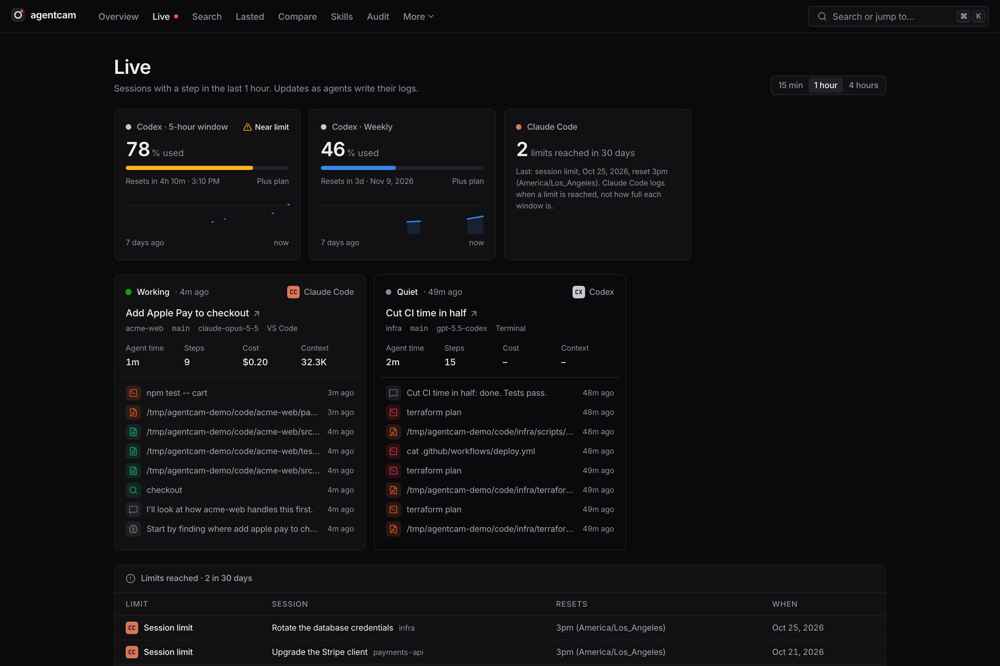
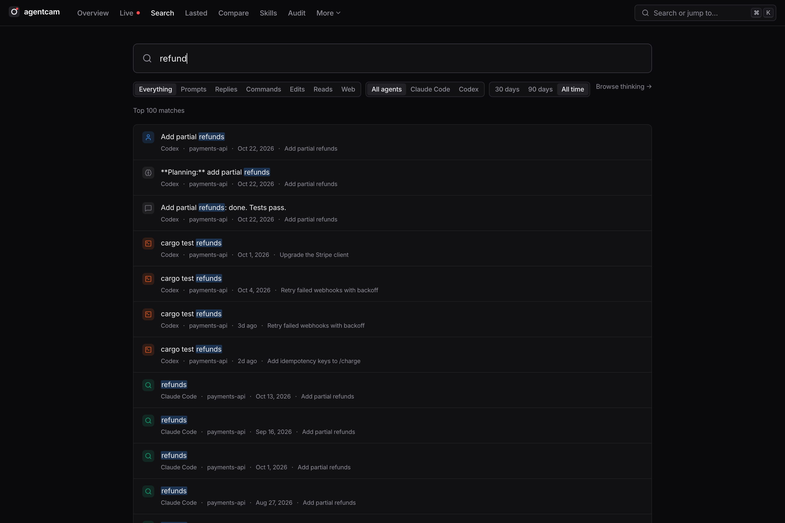
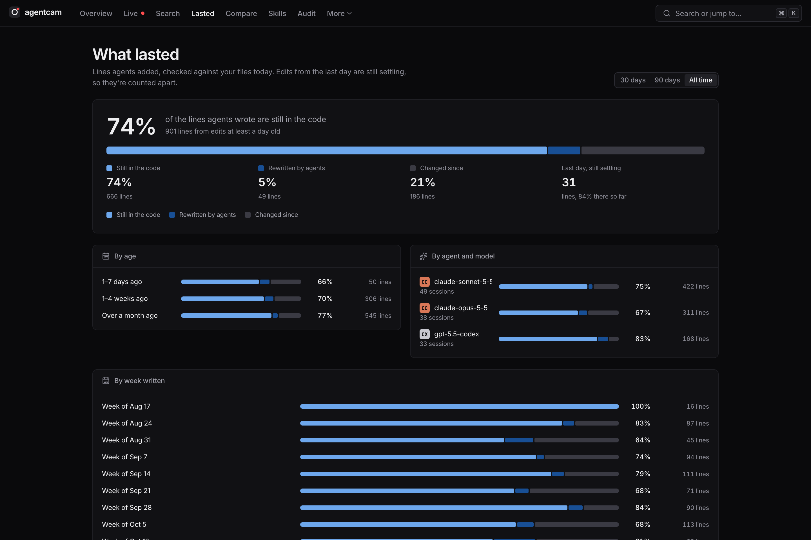
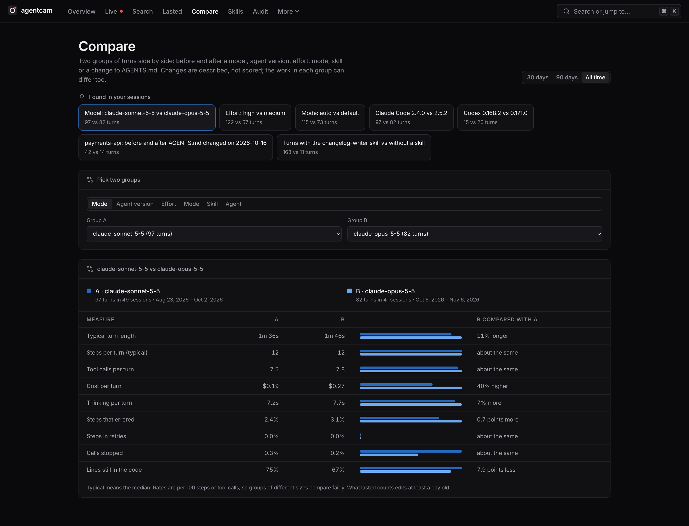
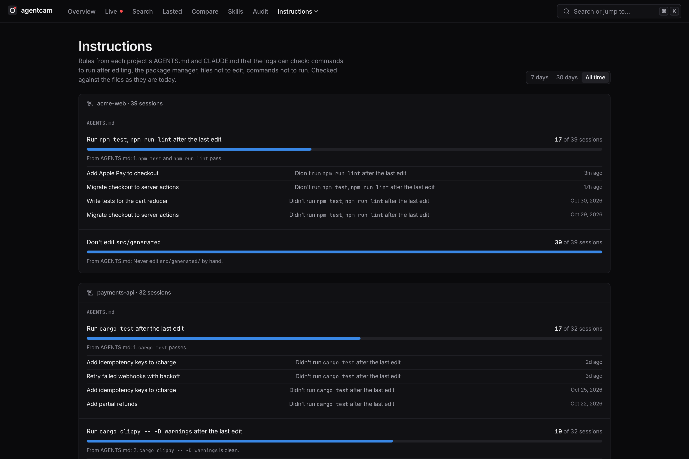
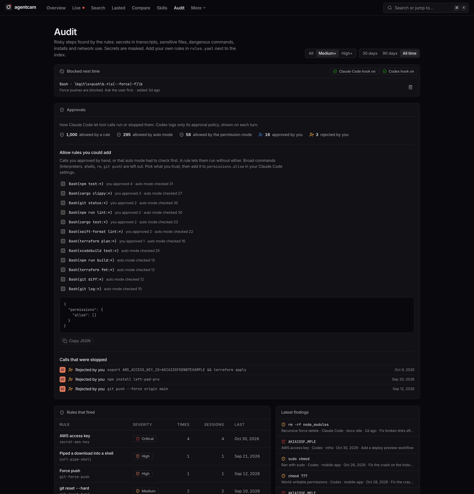
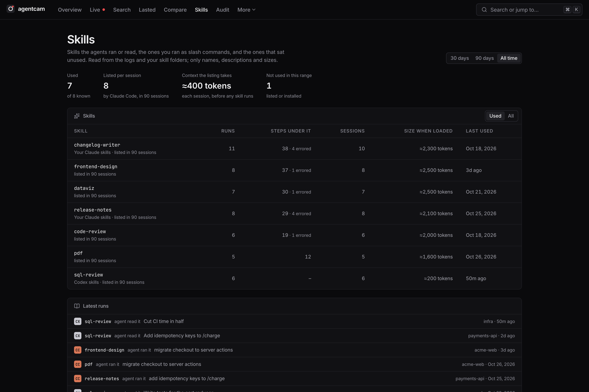

# agentcam

**A dashcam for your coding agents.**

agentcam reads the session logs that Claude Code and Codex already write on your machine and turns them into something you can look at: months of agent work at a glance, a step-by-step replay of any session, full-text search, and a risk audit of what your agents touched. One local binary. No account, no telemetry, nothing leaves your machine.



> **Status:** in heavy development and used every day, not yet packaged. Install from source below. Screenshots use made-up demo data.

## What it does

### See the work

**Overview.** Agent time, sessions, prompts, tool calls and files changed, compared with the previous period. A year-long activity heatmap, projects with weekly sparklines, every session grouped by day, and how long turns take. Agent worktrees count toward their repo, and subagents toward their parent session.

**Replay.** Scrub through a session on a zoomable timeline, or play it at 1×, 4× or 16×. The transcript follows along, split into turns: each prompt with how long it ran, its steps, cost, model, effort and mode. Each step shows its command and output, or a line-numbered diff, how it was approved, and the skill behind it. Keyboard: space, ←/→, `J`/`K`, `Shift+J` for the next file change, `E` for the next error, `R` for the next risk. Every step has its own link.



**Live.** Which agents are working right now and what they just did, with a dot in the top bar while one works.



**Search and thinking.** Full-text search across prompts, replies, commands, output and file paths, from the ⌘K palette or the search page. A Thinking page lists the longest or newest reasoning, with thinking time by model. Every hit opens the replay at that step.



### Did it work?

**What lasted.** Of the lines your agents wrote, how many are still in the code today, how many later agent edits rewrote, and how many changed since. By age, week, agent and model, project and file, and on every change in the replay. It works on your past sessions too, with nothing to install.



**Compare.** Put two groups of turns side by side: two models, agent versions, efforts, modes or skills, or before and after a date. agentcam finds comparisons worth a look, such as before and after you changed a project's AGENTS.md. It describes the changes ("24% shorter", "4 points more lines kept") and doesn't score them.



**Instructions.** agentcam reads each project's AGENTS.md and CLAUDE.md and keeps the rules a log can check: commands to run after the last edit, the package manager, files not to edit, commands not to run. See how often sessions followed each one, and jump to the ones that didn't.



**Stuck steps and commits.** Retry loops, error streaks and reverts, with the time they took. The commits each session made, and the pull requests it opened.

### Cost and limits

**Cost.** Estimated cost per step, turn, session, project and day from an editable price table. A context window chart with compactions marked.

**Usage limits.** Codex's 5-hour and weekly windows, with a 7-day chart and reset times, and every time Claude Code or Codex reached a limit.

### Safety

**Risk audit.** 28 built-in rules flag secrets in transcripts (masked before they're stored), sensitive files (`.env`, `~/.ssh`, cloud credentials, keychains), dangerous commands (`rm -rf`, `sudo`, `curl | sh`, force pushes, `git reset --hard`), package installs, domains contacted, and writes outside the project. Findings show on the replay timeline and the Audit page. Add your own rules in YAML from the Audit page.

**Approvals.** How each Claude Code tool call was allowed (a rule, auto mode, the permission mode, you) or stopped. The Audit page lists calls that were stopped and allow rules you could add, so agents ask you less. Broad commands are never suggested, and agentcam never edits your settings: you copy what you want.

**Block next time.** Turn a risky step into a guard rule. A Claude Code or Codex `PreToolUse` hook runs `agentcam guard` before each tool call and stops calls that match, with a message to the agent.



### Skills and tools

**Skills.** Which skills exist, which the agents or you ran, which sit unused, and how much context each one and the skill listing take.



**Tools and files.** Use, errors and time per tool; skills, plugins and MCP servers behind steps; the most changed files and each file's history.

### Share and export

**Report cards.** PNG cards for a session or your week, with titles, projects and file names hidden by default.

**OpenTelemetry.** `agentcam export otlp` sends sessions as traces to Jaeger, Grafana Tempo or Honeycomb, with subagents nested under the call that started them.

**Outbox.** A preview of the metadata a future team server would receive: counts, times, tokens, findings and file paths relative to the project. Never prompts, output or diffs. Nothing is sent today.

## Install

Not published yet. You need Rust (stable) and Node 20+.

```sh
git clone https://github.com/chauhanswapnil/agentcam
cd agentcam
npm --prefix web ci && npm --prefix web run build
cargo install --path crates/agentcam
agentcam
```

`agentcam` indexes your logs, starts a server on `http://127.0.0.1:4747` and opens your browser. Packages for `cargo install agentcam`, `npx agentcam` and Homebrew are coming.

## Commands

| Command | What it does |
|---|---|
| `agentcam` / `agentcam serve` | Index in the background, watch for new logs, open the UI (`--port`, `--no-open`) |
| `agentcam index [--full]` | Read new and changed logs, print a summary |
| `agentcam search <words>` | Full-text search from the terminal |
| `agentcam scan [--min high] [--range 30d]` | Print what the risk rules found |
| `agentcam export otlp [--range 7d] [--out f] [--endpoint url]` | Sessions as OpenTelemetry traces (OTLP/JSON); sends data only with `--endpoint` |
| `agentcam guard` | The hook command: reads a tool call on stdin, exits 2 to block it |

All of them take `--db <file>` (or `AGENTCAM_DB`) to use another index. By default the index lives in your data folder (`~/Library/Application Support/agentcam/` on macOS), next to `rules.yaml` (your rules) and `guard.yaml` (your guard rules).

## Supported agents

| Agent | Logs read from | Guard hook |
|---|---|---|
| Claude Code | `~/.claude/projects/` (including subagents) | `~/.claude/settings.json` |
| Codex | `~/.codex/sessions/` (newer and older formats) | `~/.codex/hooks.json` (trust it in `/hooks`) |

For both agents agentcam reads what the logs record: turns and their settings, approvals (Claude Code), thinking, skills, usage limits, pull requests (Claude Code), reasoning tokens (Codex), and files changed outside a session.

## Privacy

- agentcam only reads agent logs. It never edits, moves or uploads them, and never edits agent settings; the Audit page shows the hook config for you to add.
- The server listens on `127.0.0.1` only, refuses requests addressed to any other host name, and refuses cross-site writes.
- Secrets that the rules find are masked before they reach the index. Report cards hide titles, projects and file names by default.
- To show what lasted and check instructions, agentcam reads project files, AGENTS.md and CLAUDE.md on this machine. It stores counts, never file contents. It reads skill folders for names, descriptions and sizes only.
- Agent logs can hold secrets and private code. Treat agentcam's index, and any screenshot of it, with the same care as the logs.

The index keeps sessions after the agent deletes their logs. Claude Code prunes old logs; agentcam keeps the history.

## Development

See [CONTRIBUTING.md](CONTRIBUTING.md). [AGENTS.md](AGENTS.md) covers the layout, commands, design rules and how parsing, the audit and the guard work, for people and coding agents alike.

To try agentcam without your own logs, or to retake these screenshots:

```sh
python3 scripts/demo-data.py /tmp/agentcam-demo
HOME=/tmp/agentcam-demo cargo run -- --db /tmp/agentcam-demo/index.db serve
```

## License

[Apache License 2.0](LICENSE).
