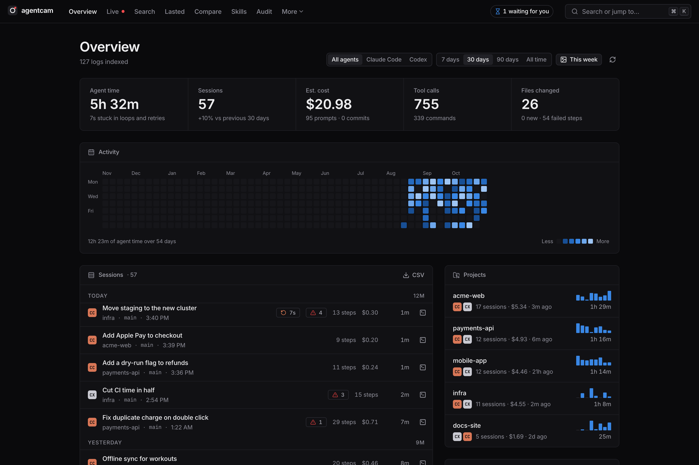

import { Card, CardGrid } from '@astrojs/starlight/components';



<CardGrid>
  <Card title="See the work" icon="seti:video">
    Months of agent work at a glance, a replay of any session with its diffs and commands, and full-text search across all of it.
  </Card>
  <Card title="Did it work?" icon="approve-check">
    How many lines your agents wrote are still in the code, which session wrote each line, and how sessions followed your AGENTS.md.
  </Card>
  <Card title="Time and cost" icon="seti:clock">
    Where agent time went, what it cost at API list prices, usage limits, and the few changes most likely to give time back.
  </Card>
  <Card title="Safety" icon="warning">
    73 built-in rules flag secrets, risky commands and data sent out. Turn any step into a guard rule that asks next time.
  </Card>
</CardGrid>

## Start in a minute

```sh
brew install chauhanswapnil/tap/agentcam
agentcam
```

agentcam indexes your past sessions, starts on `http://127.0.0.1:4747` and opens your browser. See [Install](start/install/) for npm, Windows, Cargo and the install script.

## Rules it keeps

- **Read only.** It never writes to, moves or deletes your agents' logs, and never edits agent settings.
- **Local only.** It listens on `127.0.0.1` and makes no network calls. A team server is opt-in and receives metadata, never content.
- **Zero setup.** It works from the logs that already exist. No hooks or SDK needed.
