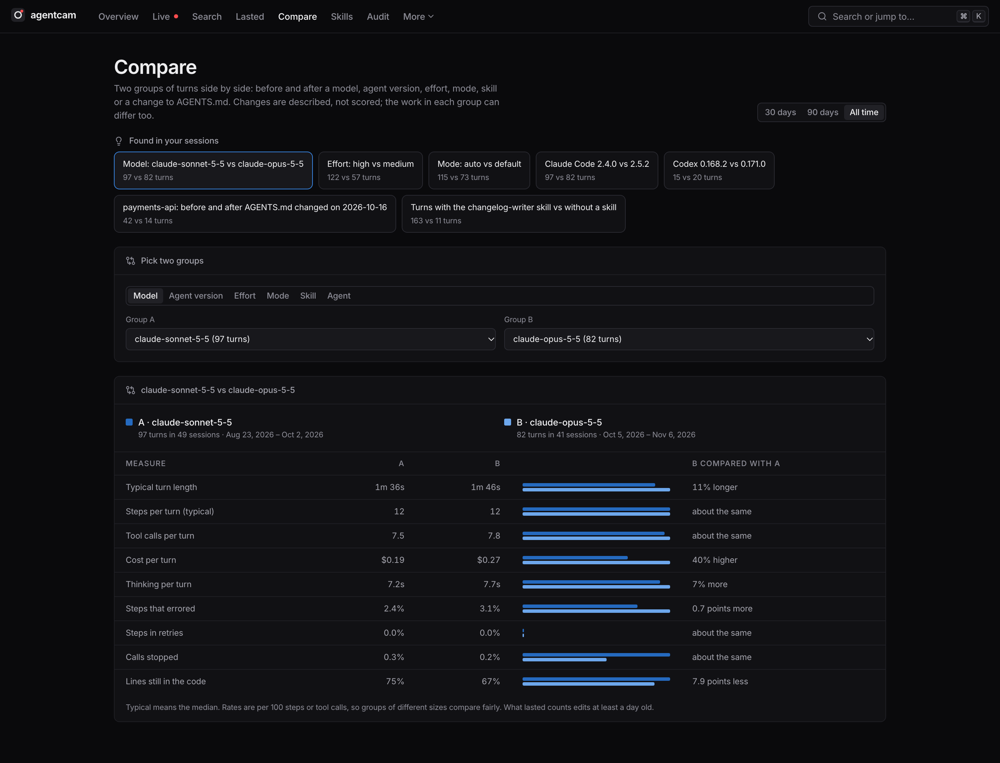
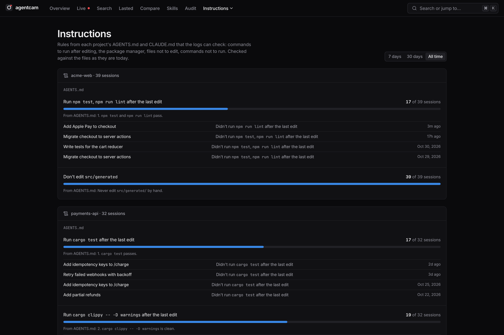

## Compare

Put two groups of turns side by side: two models, agent versions, efforts, modes or skills, or before and after a date.

agentcam suggests comparisons worth a look:

- your two most used models, efforts and modes
- each agent's newest version against the one before
- before and after the latest AGENTS.md or CLAUDE.md change in each project
- your most used skill, with and without

Numbers are medians, or rates per 100 steps or calls, so groups of different sizes compare fairly. agentcam describes changes ("24% shorter", "4 points more lines kept"). It doesn't score them; you decide what's better.

## Instructions

agentcam reads each project's AGENTS.md and CLAUDE.md (following `@file` imports) and keeps the rules a log can check:

- commands to run before you finish, or that must pass (optionally only when files under a folder changed)
- the package manager, when it isn't npm
- files or folders not to edit, including folders marked as generated
- commands not to run

It then shows how often sessions followed each rule, with links to the ones that didn't.

- Flags don't matter: `cargo test --all` counts for `cargo test`.
- Sessions that only edit docs aren't expected to run checks.
- Files are read as they are today, so a rule you just added applies to past sessions too.
