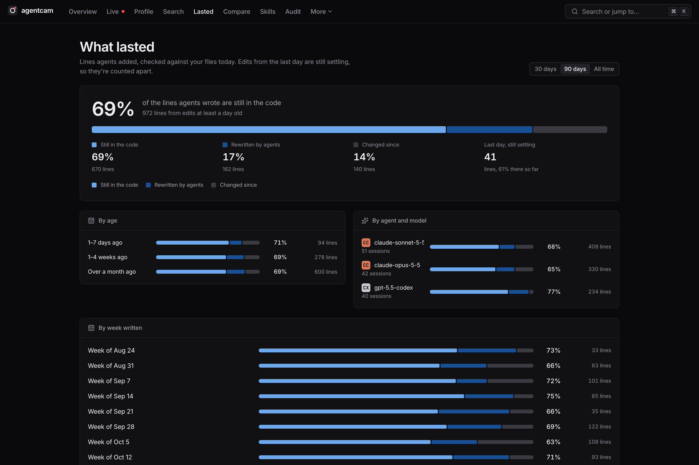
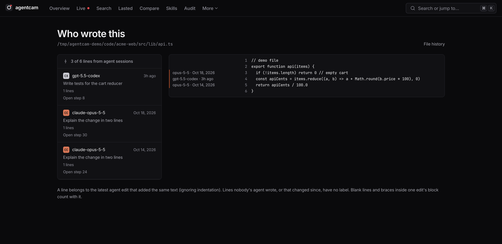

## What lasted

Of the lines your agents wrote, how many are still in the code today?



Each line falls into one of three groups:

| Group | Means |
|---|---|
| Still there | The line is in the file today |
| Reworked | A later agent edit removed it, or the agent deleted the file |
| Changed since | It's gone, and no agent edit explains it: a person or a tool changed it |

See them by age, week, agent and model, project and file. Each change in the replay carries its own counts too.

It works on past sessions, with nothing to install.

### How it works

agentcam takes the lines each edit added, from the diff in the log, and looks for them in the file on disk today by their trimmed text. Lines with fewer than three letters or digits (a lone `}`) are skipped. If an agent worked in a worktree that's gone, agentcam looks in the main repo. If a project folder no longer exists, its edits are left out rather than counted as gone.

agentcam reads your project files for this, but stores only counts, never file contents.

## Who wrote this

Open any file an agent edited and see, for each line still there, the session, model and prompt that wrote it, with a link to that step.



From the terminal:

```sh
agentcam blame src/payments/refund.ts
```

agentcam only reads files an agent edited, so this can't be used to read other files.
