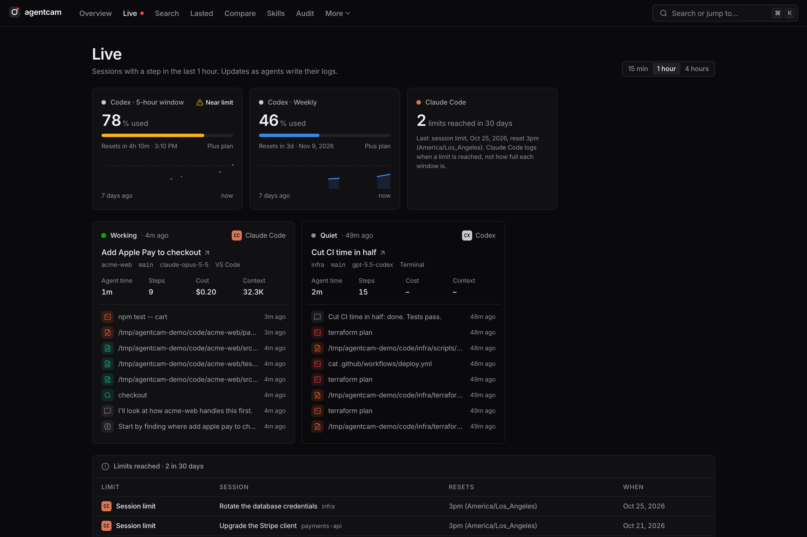

## Live

The Live page lists sessions with a step in the last 15 minutes: what each one just did, how full its context is, its cost so far, and its state.

| State | Means |
|---|---|
| Working | A step in the last 2 minutes, a tool call still running, or a subagent busy |
| Waiting | The agent replied and is waiting for you |
| Quiet | Neither |

A dot beside **Live** in the top bar shows while an agent works, with a count of sessions waiting for you.

## Alerts

agentcam can send browser notifications when:

- a session is waiting for you
- a session is done for now
- several steps in a row errored
- a session or a day passes a cost you set

Turn them on from the Alerts panel on the Live page. Your browser asks for permission the first time. You can mute projects and set quiet hours.

Alerts run in your browser tab, so the tab needs to stay open. Settings stay in that browser. The server sends nothing.
