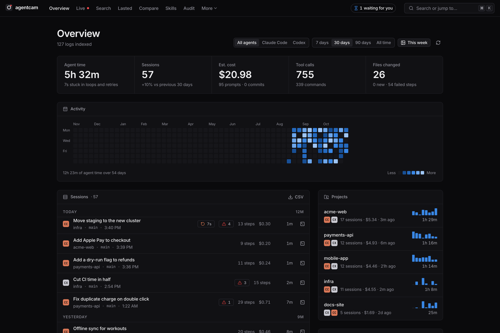

The Overview is the first page. It answers: how much did agents work, on what, and is that more or less than before?

## What it shows

- **Stats** for the range you pick: agent time, sessions, prompts, tool calls and files changed, each set against the period before.
- **Activity**: a year of agent time, one square per day. Click a day to see only that day.
- **Projects** with a sparkline of weekly agent time.
- **Sessions**, newest first, grouped by day. Each opens in the [replay](../replay/).
- **Turn lengths**: how long your turns take.
- **The top fix** from the [Profile](../profile/), if there is one.

## How agentcam counts

- **Agent time** adds up the gaps between steps, each capped at 5 minutes, so a session left open over lunch doesn't count as work.
- **Projects**: agent worktrees (`repo/.claude/worktrees/x`) count toward the repo they belong to.
- **Subagents** count toward the session that started them, and don't show as sessions of their own.

## Filters

Every list page takes the same filters, kept in the URL so you can share a view:

| Filter | Values |
|---|---|
| Range | 7 days, 30 days, 90 days, all |
| Agent | Claude Code, Codex |
| Project | any project root |
| Day | one local day |

The sessions list also narrows to sessions that used one model, or that had errors, findings or retries.

## Tools, files and commits

Pages under **More**:

- **Tools**: use, errors and time per tool, and the skills, plugins and MCP servers behind steps.
- **Files**: files touched, most changed first, and each file's history.
- **Commits**: commits sessions made, and the pull requests they opened.
