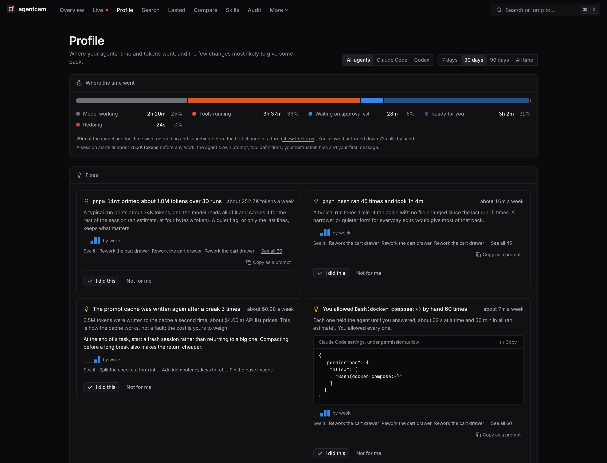

## Where the time went

Agent time splits into parts that always add up to the whole:

| Part | Means |
|---|---|
| Model | The model working out its next step |
| Tools | Tool calls running |
| Waiting on approval (est.) | A call waiting for you to allow it |
| Ready for you | The agent replied; the next prompt hadn't come yet |
| Redoing | Steps in retry loops, error streaks and reverts |

**Orienting** is a slice of model and tool time: reading and searching before the first edit of a turn.

The approval wait is an estimate. A tool call's time includes the wait, so agentcam takes off the usual run time of that tool. It leans low.

Click any part to list the steps behind it, biggest first.

## Fixes

At most five changes, ranked by how much time or money each could give back. Each comes with the steps behind it and something to copy.

| Kind | What it finds | What you get |
|---|---|---|
| Approval | A call you allow by hand again and again | An allow rule to copy |
| Slow command | A command that takes 20 s or more and runs often | A prompt to hand your agent |
| Loud command | A command whose output fills the context | A prompt, and a quieter form for well-known tools |
| Cache | Prompt cache rebuilt, for example after a break | Advice |

A fix shows only when it's big enough to matter: 10 minutes a week for time, 5% of cost for money. Broad commands (shells, `rm`, `git push`, …) are never suggested as allow rules.

agentcam never edits your files. You copy what you want.

## Ledger

Mark a fix **I did this** and agentcam measures the four weeks before against the time since, per 10 hours of agent time. It says "no change yet" as plainly as "less". A change is stated only after 7 days and 5 sessions.

**Not for me** sets a fix aside. Both marks live in `profile.json` next to the index, so they survive a rebuild.
