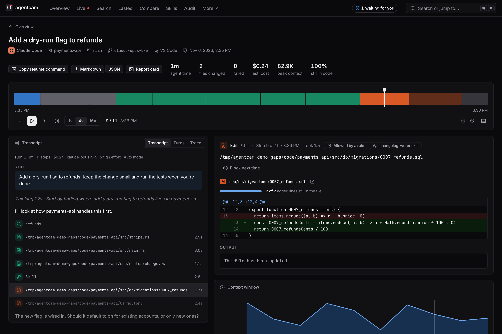

Open any session to replay it.

## The parts

- **Timeline.** Every step as a mark, colored by kind. Zoom in, drag the playhead, or play the session at 1×, 4× or 16×.
- **Transcript.** Follows the playhead. It's split into turns: each prompt you typed, how long it ran, its steps, cost, model, effort and mode.
- **Step.** The command and its output, or a diff with line numbers, how the call was allowed, and the skill or plugin behind it.
- **Side panels.** The agent's task list as it stood at that step, plans it proposed, hooks that ran, and each subagent's share of the cost.

## Colors

Steps fall into five groups, the same across the app:

| Group | Steps |
|---|---|
| You | prompts you typed |
| Changes | commands, edits, writes |
| Looks | reads, searches, web, MCP |
| Agent | replies and thinking |
| Error | steps that errored |

## Keyboard

| Key | Does |
|---|---|
| `Space` | Play or pause |
| `→` or `J` | Next step |
| `←` or `K` | Previous step |
| `Shift+J` or `Shift+→` | Next file change (`Shift+K` or `Shift+←` for the one before) |
| `E` | Next step that errored |
| `R` | Next finding |
| `Home` `End` | First or last step |
| `1` `2` `3` | Play at 1×, 4× or 16× |
| `+` `-` | Zoom the timeline |

## The header

Its numbers open what's behind them:

- **Est. cost** opens the cost split for this session.
- **Errored** and **peak context** jump to those steps.
- A **strip** shows where the session's time went: model, tools, waiting on approval, ready for you, redoing.

## Links and actions

- Every step has its own link (`?step=`). Share it to point someone at one step.
- **Resume** copies the command that picks the session up in its folder (`claude --resume …` or `codex resume …`).
- **Open in editor** opens a changed file at its line in VS Code, Cursor or Zed. Pick the editor once; agentcam remembers it.
- **Export** downloads the session as Markdown or JSON, secrets masked. See [Export and share](../export/).
- **Block next time** turns a step into a guard rule. See [Guard](../../guides/guard/).
