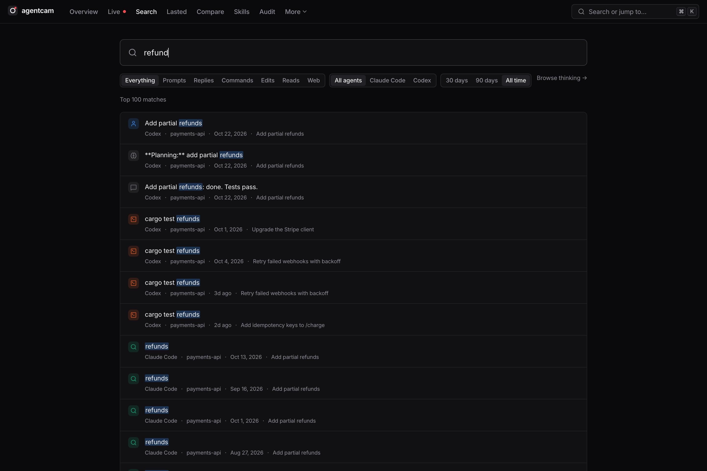
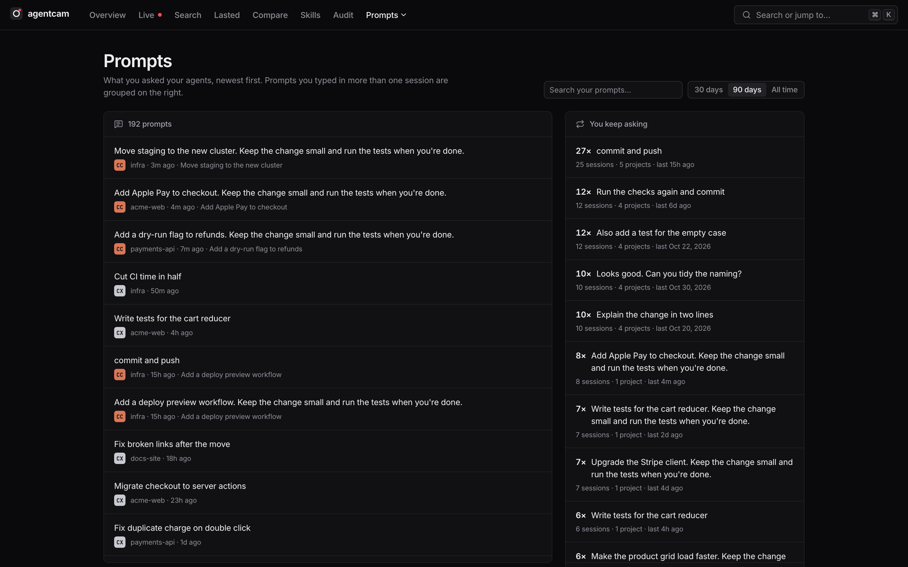

## Search

Full-text search across prompts, replies, commands, output and file paths. Open it with `⌘K` (`Ctrl+K`) or the Search page. Every hit opens the replay at that step.



- Every word must match; the last one also matches as a prefix, so results show as you type.
- Narrow by range, agent, project and kind of step. **Risky** keeps only steps with findings.

From the terminal:

```sh
agentcam search "migration rollback"
```

## Prompts

Everything you typed to an agent, newest first and searchable. Prompts you typed in two or more sessions are grouped, ignoring case, spacing and punctuation.

A prompt you keep typing might belong in a slash command, a skill or AGENTS.md.



## Thinking

The longest or newest reasoning steps, and thinking time by model.
